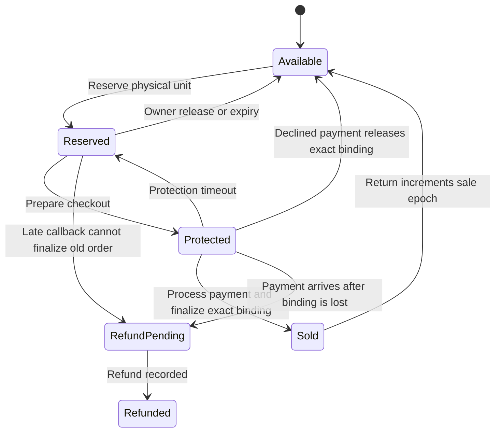

# Independently authored bounded TapCart model

This model was authored against the current application and `nfc.tex` on 6 November 2026. **It is not the paper's original model, a reproduction of the reported paper state count, or a proof of the production implementation.** The original paper artifacts were unavailable. All counts below come from the checked-in raw TLC runs for this model.

The model has one physical unit, two sessions, three orders (two for session A), two globally unique reservation IDs, two sale epochs, and a maximum of fourteen transitions. Versions and observed stale versions are separate; versions never wrap. The transition budget makes exploration finite without changing any enabled transition's protocol guards. Every prefix of length at most fourteen is explored; behavior beyond that bound is not checked. A normal return followed by a second complete sale fits inside the bound.

State separates physical-unit availability, reservation owner/ID/version, lease expiry, checkout order binding/protection, order status, external charge count, processed successful callback events, and the append-only sale ledger. Actions include competing reservations, owner release, expiry, checkout, charge retries, successful callbacks, declined-payment release, finalization, refund, return and duplicate/lost-response observations. A timeout atomically marks lease and protection expired; clocks and the two distinct lease deadlines are abstracted. Payment network failure, provider implementation, multi-unit atomicity, outbox delivery, database crash recovery, tag cryptography and liveness/fair scheduling are outside this model. PostgreSQL fault tests cover additional implementation cases.

Nine safety properties are checked:

| Property               | Meaning                                                                                                         |
| ---------------------- | --------------------------------------------------------------------------------------------------------------- |
| Structural             | Unit fields obey AVAILABLE / RESERVED / SOLD structure; protected units are reserved with an order binding.     |
| UniqueSale             | At most one sale per physical unit and sale epoch.                                                              |
| PaymentBeforeSale      | Every sale has a processed successful payment callback.                                                         |
| SingleCharge           | At most one external charge per order.                                                                          |
| OrderConsistency       | Completed orders have a sale; refunded orders had a processed payment.                                          |
| ReservationExclusivity | A direct transition between reserved states cannot replace the reservation.                                     |
| OwnerRelease           | A release is issued by the current reservation owner.                                                           |
| VersionMonotonic       | Unit version cannot decrease.                                                                                   |
| ProtectionIntegrity    | Active protection cannot be freed or rebound except by timeout, finalization or exact declined-payment release. |

`Duplicate` abstracts an idempotent replay/lost response as no domain-state effect, while still consuming a bounded step. It does not independently model a database idempotency table. Charge count and processed callback sets separately constrain provider charge and callback replay. Version monotonicity is weaker than a universal stale-write theorem: stale observed requests are enabled in the actions and are rejected by the version guard, but no extra claim is inferred from this property.

## Actual TLC results

Re-run on 7 November 2026 with the assertion-enforcing script. Official TLC 2.19 (revision `5a47802`, build 8 August 2024), Eclipse Temurin Java 21.0.13, two workers, breadth-first search. The correct configuration generated **119,986 states**, found **35,279 distinct states**, emptied the queue, and reached depth 15 (initial state plus fourteen transitions). All five invariants and four action properties passed. Raw run output, including seeds, environment and any fingerprint-collision estimate, is in `results/`.

| Configuration       | Actual result                 | Shortest counterexample                                                                           |
| ------------------- | ----------------------------- | ------------------------------------------------------------------------------------------------- |
| Correct             | No violation in bounded graph | —                                                                                                 |
| NoAvailability      | ReservationExclusivity fails  | Initial → reserve → second reserve (states 1–3)                                                   |
| NoOwner             | OwnerRelease fails            | Initial → owner reserves → other session releases (states 1–3)                                    |
| NoProtection        | ProtectionIntegrity fails     | Initial → reserve → checkout → release (states 1–4)                                               |
| NoRebinding         | ProtectionIntegrity fails     | Initial → reserve → checkout A1 → checkout A2 (states 1–4)                                        |
| NoChargeIdempotency | SingleCharge fails            | Initial → reserve → checkout → charge → charge (states 1–5)                                       |
| NoVersion           | No violation in bounded graph | Other guards make this predicate redundant in this abstraction.                                   |
| NoFinalBinding      | No violation in bounded graph | Protected-version and reservation predicates still reject stale finalization in this abstraction. |

The latter results do **not** justify removing application guards. They demonstrate the limits/redundancy of this abstraction; this model does not establish that every production predicate is independently necessary. Mutation variants are deliberately unsafe models; production code is not mutated.

The owner-release and checkout-rebinding counterexample paths are replayed step by step against real PostgreSQL in fault scenarios F9 and F7, where the application rejects the forbidden step. Concurrent reservation and protected-expiry behavior are also covered by the existing PostgreSQL protocol suite. External-charge duplication is an abstract provider requirement; no real card was charged during this work.



The chart combines order and unit views for readability. It hides request duplicates, stale rejected actions, observed-version choices and intermediate charge/callback steps; the TLA+ model retains those steps. The raw counterexample state dumps are authoritative for each reported shortest path.

## Re-run and provenance

Get the official checker from [TLA+ releases](https://github.com/tlaplus/tlaplus/releases) (`tla2tools.jar`) and a Java 17+ runtime, then run from the repository:

```sh
JAVA=/path/to/java TLC_JAR=/path/to/tla2tools.jar research/formal/run.sh
```

Each variant writes raw stdout/stderr. The script asserts the exact expected process status and property/invariant result, and requires complete queue exhaustion for passing configurations. TLC exit 0 is success, exit 12 an invariant violation and exit 13 an action-property violation. Expected negative-control violations count as successful checks; any unexpected status, wrong violated property, parse/runtime error, missing result, or incomplete passing exploration makes the script exit nonzero. `results/checks.tsv` records all assertions. A fake checker returning zero without verification output was separately tested in a temporary fixture and correctly caused script exit 1. `results/SHA256SUMS` records the model, configurations, verification script and checker binary hashes used for this run. Java/checker download locations and runtime version appear in `results/provenance.txt`. Downloaded executable binaries live in temporary storage and are not vendored into the repository.
